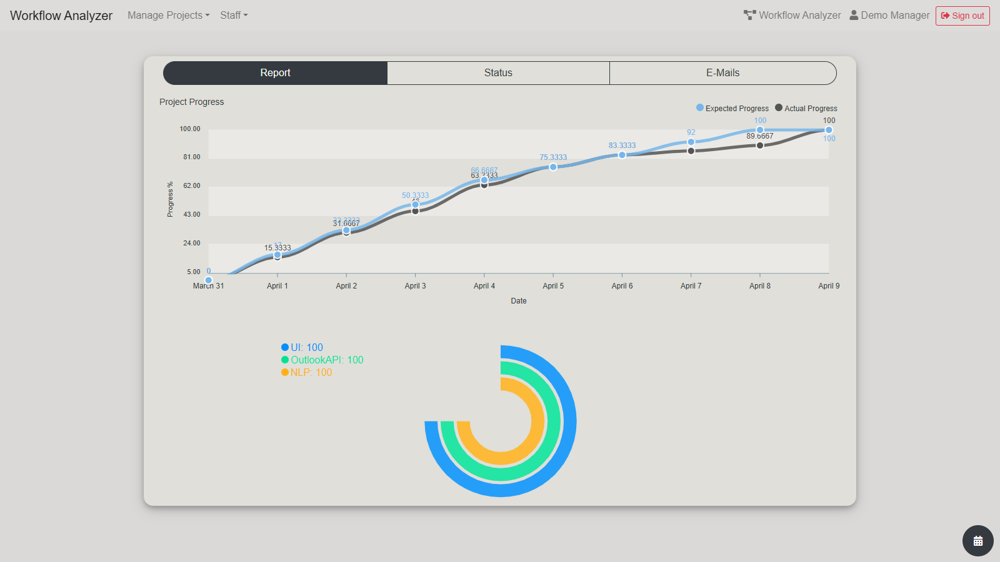
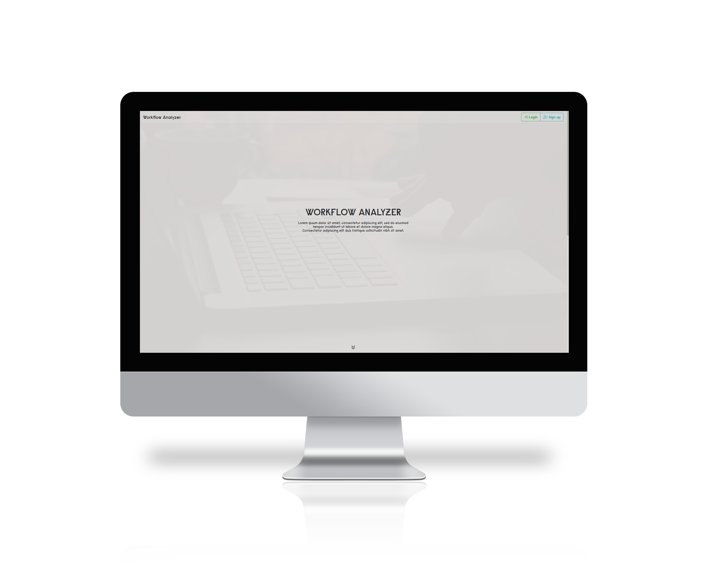
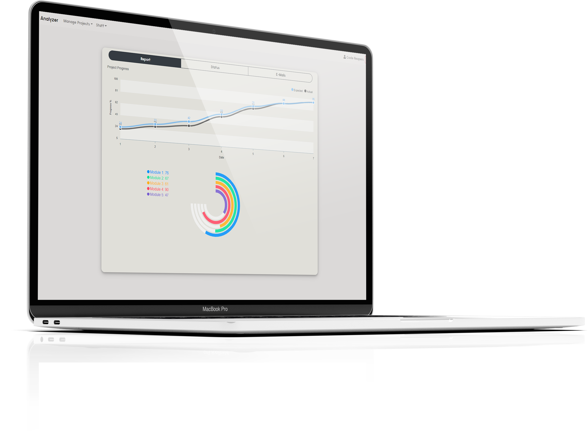
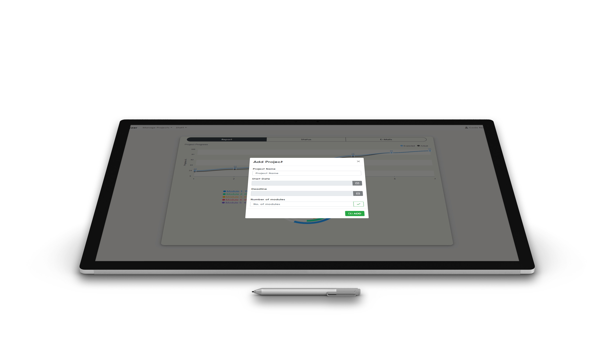
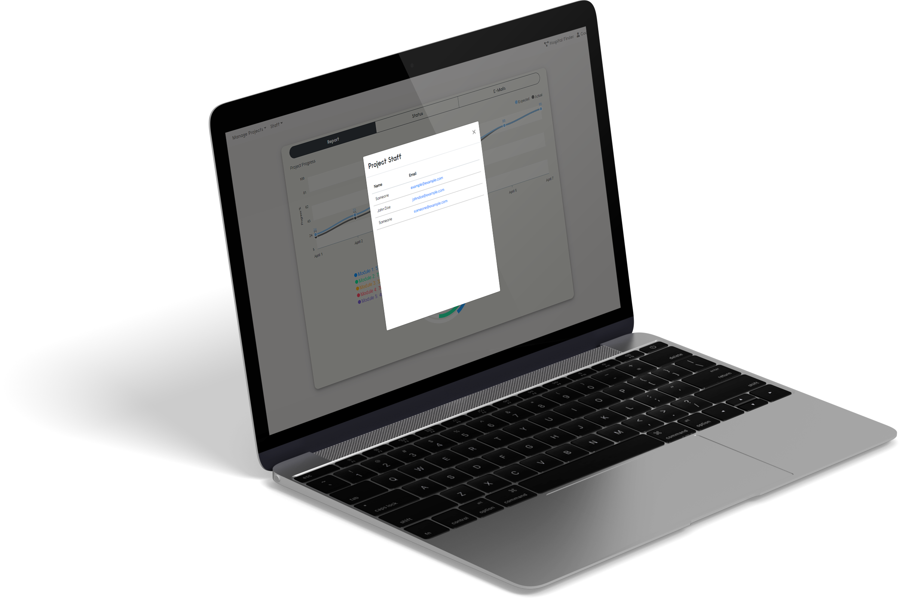

# Workflow Analyzer

A project-tracking web app that watches the e-mail your team already writes. Built in 2019 as the BE CSE minor project of team **Code Reapers** at SISTec, Bhopal.

Managers sign up, register a project with its modules and deadlines, and enroll their team. The backend then reads the project's Outlook mail through the Microsoft Graph API, runs sentiment analysis and date extraction over it with NLTK and spaCy, and turns "the NLP module will be three days late" into a progress number — no manual status reports. The dashboard shows expected vs. actual progress as interactive Vue + ApexCharts reports.



*The dashboard running against the demo data in `database/seed.sql`.*

## How it works

```
dashboard/   PHP + Bootstrap web app for project managers
             sign up / log in, add projects, modules and staff,
             browse project mail, view Vue + ApexCharts reports
backend/     Flask app + Python pipeline
             OAuth consent flow for Outlook accounts, mail & calendar
             fetching via Microsoft Graph, NLP progress estimation
database/    MySQL schema shared by both, plus optional demo data
```

1. A manager adds a project and its team on the dashboard; each member gets a consent mail and grants the app read access to their Outlook account (`backend/app.py`).
2. `backend/backend.py` periodically pulls project mail and calendar events (`fetchMailsCalendar.py`), extracts and cleans the bodies (`mail_extraction.py`).
3. `nlp_script.py` scores each mail with VADER sentiment, matches it to a module by subject, pulls dates out of the text with spaCy + dateparser, and writes expected/actual progress to `wf_module_progress`.
4. `dashboard/home.php` renders that table as a progress line chart and a per-module radial chart (Vue 2 + ApexCharts), alongside the project mail and an overall on-time/delayed verdict.

## Running it

Requirements: PHP 7.4 or 8 with mysqli, MySQL 5.7, Python 3.7 (the pinned `backend/requirements.txt` predates later Pythons). The dashboard was last checked on PHP 7.4.33 and 8.3.36 against MySQL 5.7.44.

```sh
mysql -u root -p -e "CREATE DATABASE workflow_analyzer"
mysql -u root -p workflow_analyzer < database/schema.sql
mysql -u root -p workflow_analyzer < database/seed.sql   # optional demo data

# dashboard — serve with Apache or the built-in server
cd dashboard && php -S localhost:8000

# backend
cd backend
pip install -r requirements.txt
python -m spacy download en_core_web_sm
flask run          # consent web app
python backend.py  # mail-processing pipeline
```

Configuration comes from environment variables — see [`.env.example`](.env.example). The Graph integration needs a Microsoft app registration (client ID + secret). `WFA_CONSENT_URL` and `WFA_DASHBOARD_URL` are the public base URLs of the Flask consent app and the dashboard, which link to each other; they default to `http://localhost:5000` and `http://localhost:8000`. With the demo seed loaded you can log in as `demo@example.com` / `password` and see the charts without any Outlook setup.

## Screenshots

Device mockups from the 2019 project submission:

| | |
| --- | --- |
|  |  |
|  |  |

## Team Code Reapers

- [Nishank Singh Sisodiya](https://github.com/nishanksisodiya)
- [Lalit Kumar Meena](https://github.com/lalitmeena04)
- Abhinav Karn
- [Mohit Mourya](https://github.com/mohitmourya)
- [Daljeet Singh Chhabra](https://github.com/idaljeetsingh)

## Notes on this repository

This repo was reconstructed from the 2019 project archive for preservation:

- Database and Microsoft app credentials were replaced with environment variables; the original secrets are not in the history.
- Captured mailboxes and personal data from the original deployment are excluded; `database/seed.sql` contains only anonymised demo data.
- The bundled Font Awesome 5 Pro, Google Sans and Raisonne fonts were removed because they cannot be redistributed. Icons use Font Awesome Free 5.15.4 and text falls back to the system sans-serif stack, so the look differs slightly from the 2019 screenshots.
- A handful of bugs were fixed after the import so the dashboard runs on a stock setup: dashboard queries are parameterised instead of concatenated, sessions start before they are read, the hardcoded Azure URLs became `WFA_CONSENT_URL` / `WFA_DASHBOARD_URL`, the dashboard and the demo seed set the non-strict `sql_mode` the schema depends on, and the backend modules no longer run on import (`python backend.py` drives the pipeline).
- Everything else — including the college-years code style — is as submitted. The backend has not been re-run since 2019: it still builds its SQL with string formatting, `mailsentimentanalysis.py` expects a `book.csv` that is not in the project archive, and `nlp_script.py` leans on a `datefinder` monkey-patch and 2019-era pandas behaviour.
